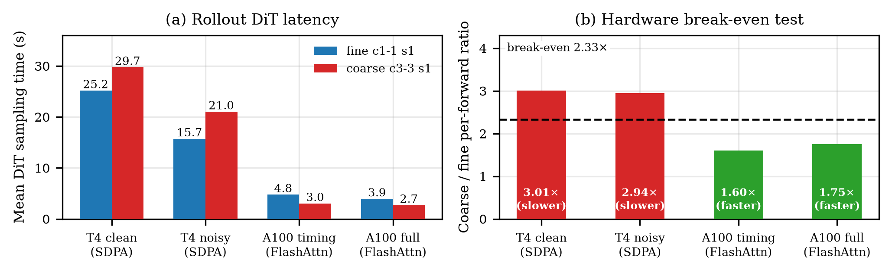
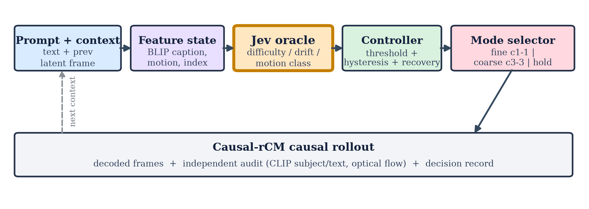
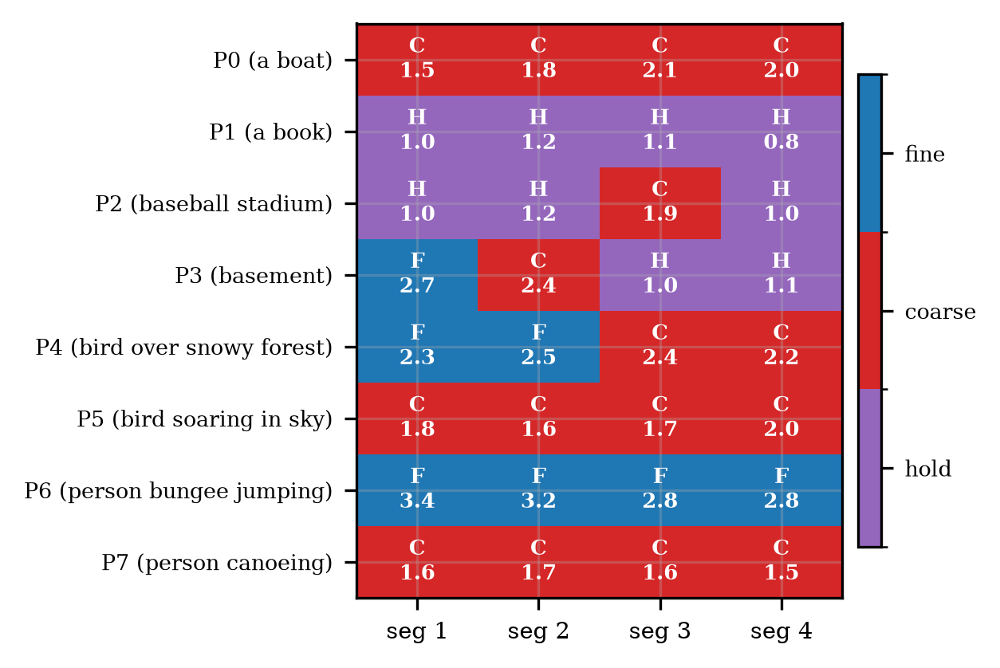
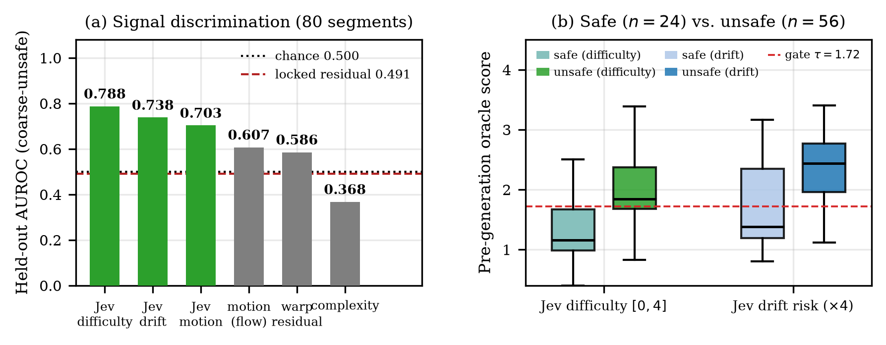
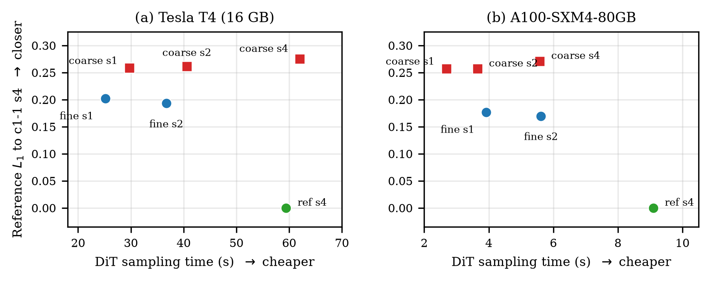
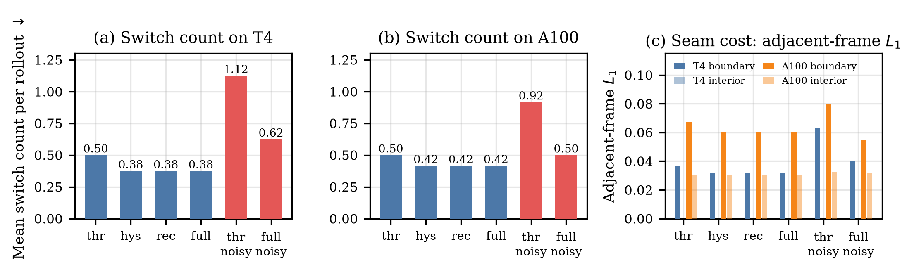
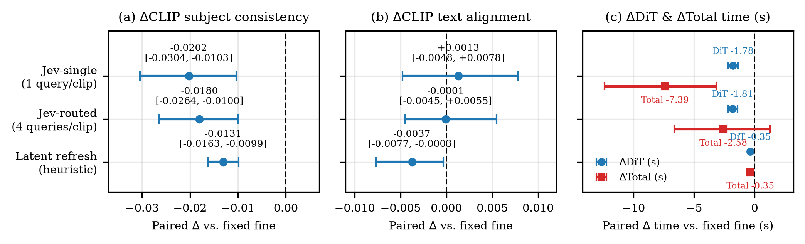
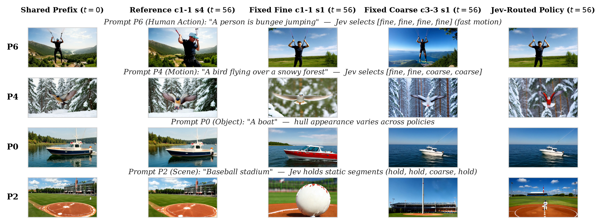

# Jev-Routed Temporal Granularity with Recovery and Hysteresis for Causal Video Generation

**Hossen Md Jisan** — Department of Artificial Intelligence, Nanjing University of Information Science and Technology (NUIST), Nanjing, China

Official code, locked protocols, calibration freezes, and audit artifacts for the manuscript *"Jev-Routed Temporal Granularity with Recovery and Hysteresis for Causal Video Generation."* Every reported experiment is reproducible from the artifacts in this repository.

---

## Overview

Causal video generators produce a rollout one temporal chunk at a time, which invites a simple efficiency idea: spend fine per-frame computation only where a segment is hard, and use cheaper coarse chunks, or even reuse, elsewhere. Realizing this idea requires three preconditions that are usually assumed rather than measured:

- **(P1) Cost.** The coarse mode must be cheaper in wall-clock time at usable quality *on the deployment hardware* — fewer denoising steps do not imply lower latency when each step becomes heavier.
- **(P2) Signal.** A quantity available *before* generation must identify the segments where coarse generation would hurt.
- **(P3) Endpoint.** The quality gain or loss must be certified by an endpoint *independent* of the modes being compared; an internal reference can silently favor one family.

This work audits all three preconditions end to end on **Causal-rCM**, a Wan2.1-1.3B text-to-video causal diffusion model, pairing a frame-wise mode (`c1-1`) with a chunk-3 mode (`c3-3`) and a near-zero-cost **hold** mode, and routing among them with a two-threshold controller with hysteresis and forced recovery. The audit runs on two GPUs with very different compute characters — a 16 GB Tesla T4 and an A100-SXM4-80GB — because the cost precondition turns out to be a property of the hardware, not of the model.

The study is deliberately evidence-preserving: **negative and failed experiments are reported as evidence**, and no claim of universal adaptive superiority is made. The value is a reproducible account of *when* the three preconditions hold, *what breaks* when they do not, and a working routing mechanism for the regime in which they do.

---

## Research questions

| | Question |
|---|---|
| **RQ1 (Signal)** | Can a quantity measured *before* a segment is generated predict whether coarse generation would be unsafe for that segment, better than chance and better than hand-crafted statistics? |
| **RQ2 (Cost–quality)** | Is there a real wall-clock versus quality trade-off from switching temporal granularity online, and is it conditional on the deployment hardware? |
| **RQ3 (Switching control)** | Do hysteresis and forced recovery reduce mode switches without worsening rollout regret, and is there a directly measurable quality cost at switch boundaries (a *seam*)? |
| **RQ4 (Monotonicity)** | Is the fine-versus-coarse benefit monotone in the pre-generation signal, so that a scalar threshold is well posed? |

---

## Key findings

- **The fine/coarse cost inversion is hardware-conditional (RQ2).** On the T4, each coarse forward is **3.01×** a fine forward against a **2.33×** break-even point, so coarse is never cheaper; on the A100 the ratio falls to **1.60–1.75** and coarse is **1.46× faster** in diffusion-transformer (DiT) time. The same model pair lies on opposite sides of break-even on different GPUs.
- **A preregistered hand-crafted signal fails; a text-only oracle succeeds (RQ1).** On 72 locked held-out cases, the hand-crafted residual signal reaches AUROC **0.491**. A text-only *System One* decision model (**Jev**) reaches AUROC **0.788** [0.575, 0.946] at **0.67 s** per decision, computed off the generation path.
- **Recovery and hysteresis stabilize switching on both GPUs (RQ3).** Switches drop from **0.50 → 0.38** on the T4 and from **0.92 → 0.50** under injected signal noise on the A100, without worsening regret. Switching carries a directly measured *seam* cost (elevated adjacent-frame L₁ at switch boundaries).
- **On fresh A100 prompts, the result is a trade-off, not dominance (RQ2).** A single-decision Jev policy saves **1.78 s** of DiT time and **7.39 s** of total time (both significant) at a small significant **−0.020** CLIP subject-consistency cost.
- **Monotonicity is signal- and endpoint-dependent (RQ4).** The fine-versus-coarse benefit is monotone in the Jev difficulty signal on the T4 but flat on the A100 diagnostic split, because the internal reference there favors the coarse family.

---

## The operating-point trap

An early comparison paired `c1-1` in its one-step regime against `c3-3` in its four-step regime and found coarse slower in **72/72** held-out cases, which naively reads as "coarse is broken" but is in fact a schedule mismatch. Coarse is cheaper in wall-clock DiT time only if

```
(s_fwd_coarse / s_fwd_fine)  <  (NFE_fine / NFE_coarse)
```

For the one-step regimes used throughout (NFE 19 vs. 8.33), the break-even ratio is **2.33**. The measured per-forward ratio is **3.01** on the T4 but **1.60** on the A100: the Ampere-class A100 with FlashAttention amortizes the heavier three-frame forward far better than the Turing T4 with SDPA.

### Cost precondition across hardware and context regime

| Setting | fine s/fwd | coarse s/fwd | ratio | coarse cheaper? |
|---|---:|---:|---:|:---:|
| T4, clean context | 1.32 | 3.58 | 3.01 | no |
| T4, noisy context | 0.71 | 2.10 | 2.94 | no |
| A100, timing arm | 0.125 | 0.200 | 1.60 | yes |
| A100, full-decode arm | 0.112 | 0.196 | 1.75 | yes |



*Rollout DiT latency (left) and the coarse/fine per-forward ratio against the 2.33 break-even point (right). The same model pair lies above break-even on the T4 and below it on the A100.*

---

## Method: Jev-routed granularity control

For each segment, a feature state (prompt, BLIP caption of the pre-decision context frame, segment index, motion statistics) is sent to the **Jev** oracle, which returns typed difficulty, drift-risk, and motion-class outputs. The controller state (threshold, hysteresis band, recovery counter) maps these to an action in **{fine, coarse, hold}**, and the selected mode executes the next causal segment. Every decision is recorded with its generated frames, independent quality measures, timing, and switch-boundary cost; all measurements are prompt-paired, and the internal `c1-1` reference is diagnostic only.



Routing uses a two-threshold controller with a hysteresis band Λ around the operating point τ and a forced recovery window of R segments after a quality spike:

```
a_t =  fine         if  Ψ_t ≥ τ_high  or recovery active
       coarse/hold  if  Ψ_t ≤ τ_low
       a_{t-1}      otherwise
```

Thresholds are calibrated on a development split only. The Jev router uses a motion-class rule (static → hold, moderate → coarse, fast/scene_change → fine) with a difficulty gate (τ_Jev = 1.72).



*Per-segment decisions over eight T4 prompts (F = fine, C = coarse, H = hold). Traces are non-degenerate: static content is held, fast motion is routed to fine, moderate motion to coarse.*

---

## Results

### Signal discrimination (RQ1)

Held-out AUROC for predicting coarse-unsafe segments. The locked study scores 72 held-out cases (288 segments); the Jev audit uses 80 paired segments from 8 fresh prompts.

| Study | Signal | AUROC | 95% CI |
|---|---|---:|---|
| Locked | residual | 0.491 | [0.393, 0.589] |
| Locked | warp | 0.454 | [0.343, 0.566] |
| Locked | motion | 0.488 | [0.377, 0.600] |
| Locked | complexity | 0.301 | [0.197, 0.412] |
| Jev audit | **Jev difficulty** | **0.788** | [0.575, 0.946] |
| Jev audit | Jev drift risk | 0.738 | [0.479, 0.945] |
| Jev audit | Jev motion (choice) | 0.703 | [0.472, 0.873] |
| Jev audit | motion (hand-crafted) | 0.607 | [0.260, 0.857] |
| Jev audit | warp (hand-crafted) | 0.586 | [0.222, 0.836] |
| Jev audit | complexity (hand-crafted) | 0.368 | [0.184, 0.562] |

The preregistered hypothesis fails on locked data: the residual signal's held-out AUROC is **0.491**, and its paired advantage over the strongest calibration baseline (warp) is 0.0367 with 95% CI [−0.0493, 0.1194] including zero. Re-labeling the same 80 paired segments with the Jev oracle reverses the conclusion. **The signal content, not the label, was the bottleneck.**



### Cost–quality sweep (RQ2)

Six-mode sweep, T4 vs. A100-80GB. Fewer NFEs do not imply lower DiT time: on the T4 every coarse mode sits above and to the right of fine `c1-1` s1, while on the A100 the coarse family occupies a cheaper, less accurate frontier point.

| Mode | T4 DiT (s) | T4 NFE | T4 refL1 | A100 DiT (s) | A100 NFE | A100 refL1 |
|---|---:|---:|---:|---:|---:|---:|
| ref `c1-1` s4 | 59.42 | 64.0 | 0.0000 | 9.10 | 64.0 | 0.0000 |
| fine `c1-1` s1 | **25.16** | 19.0 | **0.2019** | 3.92 | 19.0 | **0.1769** |
| fine `c1-1` s2 | 36.73 | 34.0 | 0.1930 | 5.62 | 34.0 | 0.1697 |
| coarse `c3-3` s4 | 62.05 | 21.3 | 0.2750 | 5.58 | 21.3 | 0.2712 |
| coarse `c3-3` s2 | 40.63 | 12.7 | 0.2615 | 3.65 | 12.7 | 0.2571 |
| coarse `c3-3` s1 | 29.72 | **8.3** | 0.2588 | **2.69** | **8.3** | 0.2575 |



VAE decode falls from ≈156 s (T4) to ≈2.4 s (A100) and stops dominating the total. **The quality–cost trade-off exists on the A100 and is absent on the T4.**

### Controller ablation (RQ3)

Switches are per rollout; AUH is area-under-horizon refL1 regret; seam/interior are adjacent-frame L₁ at switch boundaries and interior positions.

| GPU | Controller | switches | AUH | terminal | seam / interior |
|---|---|---:|---:|---:|---|
| T4 | threshold-only | 0.50 | 0.3133 | 0.3171 | 0.0364 / 0.0280 |
| T4 | **full** | **0.38** | **0.3116** | **0.3104** | 0.0321 / 0.0273 |
| T4 | threshold (noisy) | 1.12 | 0.3159 | 0.3172 | 0.0630 / 0.0290 |
| T4 | **full (noisy)** | **0.62** | **0.3150** | **0.3139** | 0.0399 / 0.0260 |
| A100 | threshold-only | 0.50 | 0.2767 | 0.2955 | 0.0672 / 0.0305 |
| A100 | **full** | **0.42** | 0.2772 | 0.2977 | 0.0601 / 0.0303 |
| A100 | threshold (noisy) | 0.92 | 0.2741 | 0.2997 | 0.0793 / 0.0326 |
| A100 | **full (noisy)** | **0.50** | **0.2718** | **0.2921** | 0.0551 / 0.0315 |



Recovery plus hysteresis reduces switching without worsening regret: **0.50 → 0.38** switches on the T4 and **0.92 → 0.50** (−45%) under noise on the A100. The mechanism's premise — that switching has a cost — is directly measured: adjacent-frame L₁ at switch boundaries exceeds interior positions (0.0364 vs. 0.0280 on the T4; 0.0672 vs. 0.0305 on the A100).

### Confirmatory study: a trade-off, not dominance (RQ2)

Prompt-paired bootstrap differences against fixed fine (24 fresh A100 prompts, 10,000 resamples, 95% CIs). Significant intervals are bold.

| Policy | ΔCLIP subj. cons. | ΔCLIP text align. | ΔDiT (s) | ΔTotal (s) |
|---|---|---|---|---|
| **Jev-single** | **−0.0202** [−0.0304, −0.0103] | +0.0013 [−0.0048, +0.0078] | **−1.78** [−2.20, −1.37] | **−7.39** [−12.39, −3.16] |
| **Jev-routed** | **−0.0180** [−0.0264, −0.0100] | −0.0001 [−0.0045, +0.0055] | **−1.81** [−2.20, −1.41] | −2.58 [−6.62, +1.26] |
| latent refresh | **−0.0131** [−0.0163, −0.0099] | −0.0037 [−0.0077, −0.0003] | −0.35 [−0.36, −0.34] | −0.35 [−0.43, −0.26] |



The honest reading is a trade-off: Jev-single saves DiT and total time — both significant — at a small significant loss in CLIP subject consistency; text alignment is unchanged. Signal accuracy alone does not certify the system; the independent endpoint is what turns the saving into a measured price.

### Qualitative evidence



Representative decoded frames from matched 57-frame T4 rollouts for four prompts. For a fast-motion human-action prompt the fixed coarse rollout drifts to a different person over a different background, while fixed fine and the Jev-routed rollout preserve the subject. These images are qualitative context only; every claim uses the numeric audits and the independent endpoints.

---

## Repository layout

```
.
├── README.md               This document
├── LICENSE                 MIT License
├── CITATION.cff            Citation metadata
├── requirements.txt        Python dependencies
├── proposal.tex            Research specification
├── paper/                  Manuscript source, bibliography, figures, compiled PDF
│   ├── main_updated2.tex
│   ├── references_ieee.bib
│   ├── figures/            All manuscript figures (PDF + PNG)
│   └── main_updated2.pdf
├── docs/                   Protocols, audit notes, and the project Pages site
│   ├── A100_PROTOCOL.md
│   ├── F1_AUDIT.md
│   ├── F2_PROTOCOL.md
│   ├── PAPER.md
│   └── index.html          Static landing page (SEO)
├── config/                 Locked manifests and calibration freezes
├── src/                    Core packages (inference, controller, uncertainty, evaluation)
├── scripts/                Audit and figure-generation scripts
├── jobs/                   Reproducible job definitions (Kaggle kernel sources)
├── colab/                  A100 Colab arm (timing, sweep, online, RQ3)
└── results/                Small JSON/JSONL audit artifacts (no media; see below)
```

Large result media (video files and video archives) are **not** tracked in this repository in order to keep clones fast. They are hosted on Kaggle and are linked from the [Videos and raw media](#videos-and-raw-media) section.

---

## Reproducing the audit

The locked protocols, calibration freezes, and audit scripts are included so that each reported number can be regenerated from saved artifacts.

```bash
# 1. Install dependencies
pip install -r requirements.txt

# 2. Model checkpoints and text encoder/VAE are hosted on Kaggle (see links below).
#    Set the Jev (TypeSafe) key in the environment; it is never committed.
export TYPESAFE_API_KEY=...        # Windows PowerShell: $env:TYPESAFE_API_KEY="..."

# 3. Re-run an audit (example: the RQ3 controller ablation)
python scripts/rq3_audit.py

# 4. Regenerate a manuscript figure (example: the signal AUROC figure)
python scripts/jev_figure.py
```

Key entry points:

| Script | Purpose |
|---|---|
| `scripts/jev_query.py` | Query the Jev System One oracle per segment state |
| `scripts/jev_audit.py` | Jev signal AUROC audit |
| `scripts/f1_mode_cost_audit.py` | Six-mode cost sweep (T4) |
| `colab/a100_sweep.py` | Six-mode cost + quality sweep (A100) |
| `scripts/rq3_audit.py` | Recovery + hysteresis controller ablation |
| `scripts/rq4_audit.py` | Fine-versus-coarse monotonicity |
| `scripts/phase3_ci.py` | Confirmatory prompt-paired bootstrap |

All A100 runs pin upstream commit `ed3cb14dd936f92cdc9f9381af7369991509b41f` of Causal-rCM.

---

## Hardware

| | Tesla T4 | A100-SXM4-80GB |
|---|---|---|
| Memory | 16 GB | 80 GB |
| Attention | PyTorch SDPA | FlashAttention-2 |
| VAE decode (57 frames) | ≈156 s | ≈2.4 s |
| Coarse/fine per-forward ratio | 3.01 | 1.60–1.75 |
| Coarse cheaper? | No | Yes |

---

## Videos and raw media

To keep the repository lightweight, full result videos are hosted on Kaggle rather than committed to Git. The relevant artifacts:

- Kaggle profile: [kaggle.com/ajjisan](https://www.kaggle.com/ajjisan)
- Controller ablation (RQ3): [ajjisan/f-rq3-controller-ablation](https://www.kaggle.com/code/ajjisan/f-rq3-controller-ablation)
- Monotonicity (RQ4): [ajjisan/f-rq4-monotonicity](https://www.kaggle.com/code/ajjisan/f-rq4-monotonicity)

The small JSON/JSONL audit outputs behind every table and figure in the manuscript are committed under `results/`.

---

## Citation

If you use this work, please cite:

```bibtex
@article{jisan2026jev,
  title   = {Jev-Routed Temporal Granularity with Recovery and Hysteresis for Causal Video Generation},
  author  = {Jisan, Hossen Md},
  year    = {2026},
  note    = {Manuscript prepared for IEEE Transactions on Circuits and Systems for Video Technology}
}
```

See [`CITATION.cff`](CITATION.cff) for machine-readable metadata.

---

## License

Released under the [MIT License](LICENSE).

## Contact

Hossen Md Jisan — jisanahammed1952@gmail.com
